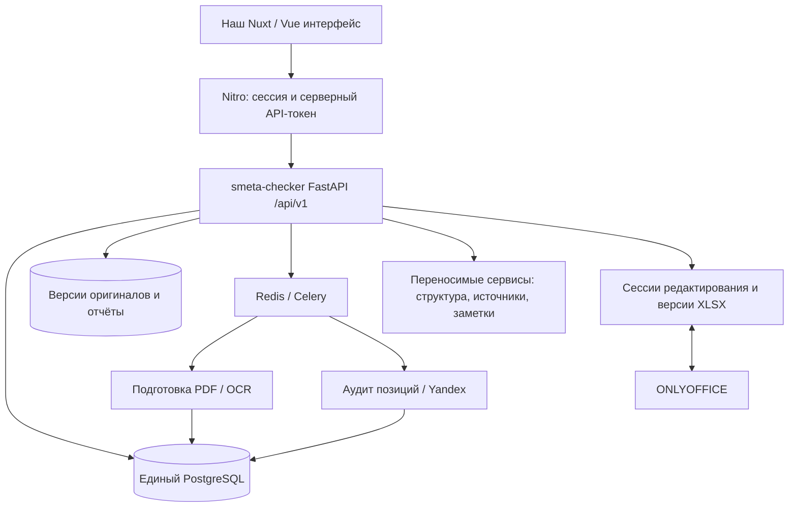

# Объединение интерфейса КДФП и smeta-checker/dev

Дата исследования: 19 октября 2026, Asia/Novosibirsk.

## Результат и границы этого этапа

Создан [fork Andrew2002acmr/smeta-checker](https://github.com/Andrew2002acmr/smeta-checker/tree/dev). Ветка `dev` в fork и исходная `koden585/smeta-checker/dev` совпадают: `7d60864b45e45f942f47a30d859bc688d4fef951`. GitHub скопировал все ветки, поскольку копирование только `main` не включило бы нужную `dev`.

Локальная копия: `D:\VOR\smeta-checker-integration`, рабочая ветка `integration/nuxt-review`. `origin` указывает на fork, `upstream` — на исходный репозиторий. Эта рабочая ветка создана от `dev`, не от `main`.

Наш актуальный интерфейс найден в `C:\Users\a.kriuchkov\Desktop\VOR\document-intelligence-work-pc\document-intelligence\frontend`. Основание выбора: Nuxt-конфигурация и отчёт `reports/nuxt-migration/MIGRATION.md` от 19 октября; его сценарии подтверждены чтением компонентов и API. Это каталог без Git-истории, поэтому SHA-256 изученных файлов записаны в [inventory.json](inventory.json). Корневой `D:\VOR\vorcheck` — другой, более ранний интерфейс; основой интеграции выбран Nuxt.

Выполнено исследование исходников и контрактов. Работающее приложение не переключалось на новый backend. Исходники интерфейса, пользовательские документы, базы и модели не переносились и не изменялись. Этот документ описывает предлагаемые изменения, а не готовую интеграцию.

## Рекомендация

Сохранить внешний вид и пользовательские сценарии Nuxt, сделать `smeta-checker` основным сервером аудита, дополнить его API и перенести нужные сервисы документов из `document-intelligence`. Серверный слой Nuxt (Nitro/BFF) оставляем для сессии, закрытого API-токена и передачи запросов. Бизнес-правила и вычисление статусов должны оставаться в Python.

Простой перенос `frontend/` и замена `NUXT_BACKEND_URL` не работают. Текущий BFF допускает только `/api/projects/...`; новый сервер предоставляет `/api/v1/...`. Кроме путей различаются модели загрузки, идентификаторы, результаты, ошибки и жизненный цикл запуска.

Инвентаризация нашла **6 прикладных HTTP-операций** нового сервера и **48 операций `/api/projects...`** в сохранённом OpenAPI нашего сервера. Совпадающих пар HTTP-метод + путь — **0**. Это сравнение контрактов, не оценка количества функций: не все 48 операций используются Nuxt, а некоторые функции нового сервера пока доступны только из Streamlit/Python.



Это целевая схема. На время переноса существующий стенд остаётся контрольным. Постоянная эксплуатация двух независимых реестров проектов и версий усложнит привязку доказательств и сохранений; её лучше не делать целевой архитектурой.

## Что уже реализовано

| Область | Наш document-intelligence + Nuxt | smeta-checker/dev | Решение |
|---|---|---|---|
| Интерфейс | Nuxt 4.6.2, Vue 3.5.44, Nuxt UI, TypeScript, PDF.js | Streamlit | Переносим Nuxt и визуальные компоненты |
| Сервер | FastAPI, `/api/projects/...`, project-scoped доступ | FastAPI, `/api/v1/...`, общий Bearer token | Основой становится новый API; BFF адаптируем |
| Загрузка | Проект → документы → асинхронная обработка версии → `demo-intake` | Multipart `project`, `kind`, `file`; загрузка и проверка формата в запросе | Переписать поток `/upload` |
| Форматы | UI принимает XLSX/PDF | XLSX/CSV/PDF | Добавить CSV; отдельно описать недоступность XLSX-редактора/оформления для CSV |
| Аудит | Локальная сверка D/E/PDF и доказательств | Подготовка PDF, поиск, LLM-аудит, проверка цитат, отчёты | Сохранить движок нового backend; наши расчёты подключать отдельными проверками |
| Фоновая работа | ProcessingRun; `queued/running/completed/failed` | Celery `pdf/llm`, position jobs; audit `running/done/failed` | Переработать модель прогресса и остановки polling |
| История | Проекты и задания обработки; текущий результат проекта | Сохранённые audit runs и результаты; список есть в Repository/Streamlit | Добавить HTTP-список запусков; UI привязать к `run_id` |
| Файлы и версии | Реестр, SHA, оригиналы; отдельные версии редактора | PostgreSQL + file blobs + SHA и номера версий | Использовать единый реестр smeta-checker |
| Просмотр PDF | Физическая/печатная страница, масштаб, выделения, поиск | В Streamlit есть инспектор; API не отдаёт оригиналы | Добавить доступ к исходной версии PDF с Range/206 |
| Структура PDF | Дерево разделов/таблиц/приложений, backlinks | Публичного контракта дерева нет | Адаптировать `app/document_structure.py` |
| Исходные строки Excel | Лист, строка, адреса ячеек, окно таблицы, D/E/PDF | Парсер даёт очищенные позиции; исходные адреса потеряны | Расширить происхождение позиции до подключения полного workspace |
| Excel-редактор | ONLYOFFICE, JWT, callback, save receipt, история, восстановление | Нет | Перенести bridge и переработать хранилище редактора |
| PDF-заметки/экспорты | Заметки, PDF и XLSX с выделениями | Нет соответствующих API | Перенести отдельным этапом |
| Отчёты | Наши annotated exports | Excel и Word аудита готовы | Подключить готовые отчёты; annotated exports сохранить отдельным видом |
| Оформление ВОР | Иная собственная логика арифметики/источников | `vor_rules.py`, доступ из Streamlit | Добавить API правил; не переносить правила в JavaScript |
| Контракты | Pydantic DTO → OpenAPI → SDK/TS/Zod | Обёртки типизированы, `results: list[dict[str, Any]]` | Сначала типизировать результат, затем генерировать клиент |

## Критические несовпадения

### 1. Проект, версия, запуск и позиция — разные сущности

В smeta-checker один audit run содержит **одну ВОР** и выбранные PDF. В нашем интерфейсе комплект может включать несколько ВОР. Для первой версии можно запускать отдельный аудит для каждой ВОР и объединять их в UI. Для постоянного понятия «проверка комплекта» потребуется сохраняемый `audit_batch` с выбранными версиями и дочерними `run_id`, иначе после обновления страницы состав комплекта потеряется.

Нельзя использовать название проекта или SHA как единственный идентификатор сущности. Рекомендуемые ключи: `project_id`, `document_id`, `version_id`, `run_id`, `(run_id, position_index)`. SHA подтверждает байты конкретной версии. `evidence.document_id` сейчас фактически заполняется именем ключа PDF-пула, а не UUID реестра; связь с версией нужно явно разрешать через `run.config.pdf_versions` и сохраняемые `pdf_version_id/pdf_sha256`.

`storage_db.Repository.load_run()` сортирует результаты по `position_index`, но возвращает только JSON результата. Сам индекс не включён; `_position_result_payload()` тоже его не сохраняет. Позицию в UI нельзя идентифицировать порядковым номером в отфильтрованном массиве. Нужно вернуть индекс и стабильный ID отдельными полями.

### 2. Результатов недостаточно для нашего окна сверки

Нужны одновременно исходная ВОР, результат аудита и происхождение доказательства. Сейчас REST не возвращает исходный объём/единицу/формулу как типизированный снимок позиции, лист, адреса D/E/ссылок, исходный номер строки и окно Excel. Часть исходных значений есть в `position_jobs.payload` и оригинале ВОР, но готового публичного DTO нет.

Парсер `vor_parse.py` читает XLSX через `pandas.read_excel` без `sheet_name`, то есть первый лист. После отбора строк выполняется `reset_index(drop=True)`. В `VorPosition` нет листа и исходной Excel-строки. Требуются сохранение координат до фильтрации, явная обработка выбранных листов и различение исходной формулы, её кешированного значения и текстового расчёта. Нельзя вычислять Excel-строку как `index + константа`: заголовки и строки-продолжения нарушат привязку.

### 3. Статусы нельзя переименовать один к одному

Наши `fix/review/missing/ok` — очереди, рассчитанные по отдельным сравнениям D/E/PDF. У нового backend доменные статусы: `ОК`, `Ошибка`, `Неполная проверка`, `Технический сбой`. В `audit_reports.build_user_report` есть дополнительная проекция для человека: расхождение, ручная проверка, проверка не выполнена, ОК.

Нужно выделить общий Python-построитель представления одной позиции и использовать его и в API, и в Excel/Word. В нём хранить отдельно `audit_status`, `report_status`, `queue_group`, вывод, рекомендуемое действие и флаги подтверждения. Значение `Ошибка` само по себе не означает доказанное количественное расхождение. Технический сбой не является ошибкой проектной документации. Завершение run со статусом `done` не означает, что все позиции проверены успешно.

Наше `E` — результат расчёта/пояснения в ВОР. Их `volume_calculation` — конкретный расчёт по проектным доказательствам, например площадь × толщина. Эти поля нельзя считать эквивалентными. Отсутствующие D/E-сравнения должны быть явно недоступны, а не заполняться нулями или выдуманным `equal`. Расхождение только E при подтверждённом D требует сохранения существующей осторожной трактовки.

### 4. PDF-доказательство ещё не является выделением

`Evidence` содержит `document_id`, физическую страницу с нумерацией от 1, цитату и её тип. Координат bbox и печатной страницы в нём нет. Наш `PdfPanel.vue` ожидает исходный файл и размеры страницы/прямоугольники для наложения выделений.

Первый рабочий просмотр: открыть точную версию PDF на физической странице и показать цитату рядом. Для нативного текста можно локализовать однозначную цитату; неоднозначность оставить без выделения. Для скана требуются сохранённые координаты OCR. Из цитаты по Markdown/HTML нельзя автоматически получить bbox. Печатная и физическая страницы остаются разными полями; преобразование поворота/CropBox должно быть частью контракта.

`pdf_binding.resolve_position_pdfs` явно отклоняет позицию с несколькими разными PDF. Такой случай нужно показывать в preflight; поддержка доказательств одной позиции из нескольких документов — отдельное изменение движка, не доработка CSS.

### 5. Предварительная проверка, прогресс и ошибки

Новый сервер уже предоставляет preflight, но `POST /audits` сохраняет `has_critical_error`, не отклоняя весь запуск по этому признаку. В UI нужно дать пользователю исправить привязки или явно видеть, какие позиции не смогут быть проверены; при необходимости определить серверную политику запуска.

`AuditStatusResponse.position_count` сейчас равен числу уже записанных результатов, а не общему числу позиций. Для процентов нужны отдельные `total`, `queued`, `running`, `done`, `failed`, стадия и признак завершённой подготовки. До известного total показывать стадию, а не фиктивный процент. Результаты/отчёты до завершения дают 409; это нормальное состояние ожидания.

Новые ошибки имеют вид `{"error":{"code","message","details"}}`; наш `backendError()` читает `detail/statusMessage/message` на верхнем уровне. Нужно адаптировать обработку и сохранять `X-Request-ID`. Лимит нового аудита по умолчанию — 32 документа вместе с ВОР, наш UI допускает 50 файлов в комплекте; нужно различать лимит комплекта и одного запуска.

### 6. Редактор и локальный режим не переносятся настройкой URL

Наш `app/web_editor.py` зависит от `configured_roots`, локального корпуса и `EditorStore`. Последний хранит ревизии, сессии, заметки и подтверждения сохранения в собственной SQLite. При переносе связать эти сущности с проектами и версиями нового backend и добавить миграции, сохранив проверку JWT, ограничение callback URL, поколения сессий и подтверждение конкретного save request.

Сохранение Excel должно создавать новую `document_version`; старый аудит остаётся привязан к прежней версии. Новый анализ — отдельный run. История редактирования и история аудитов — разные сущности.

`frontend/server/utils/access.ts` допускает только loopback и локальный Host. Наш Compose использует Linux host networking, тогда как новый Compose — обычную сеть сервисов. Для первого локального стенда это совместимо с нативным Nitro и API на loopback. Для серверной версии потребуется отдельная схема входа и проверки прав проектов; удаление `assertLocal` само по себе не создаёт авторизацию. Общий `AUDIT_API_TOKEN` не является пользовательской сессией.

## Предлагаемые изменения API

Это проект контракта; перечисленные ниже новые методы ещё не реализованы. Вводить их рядом с существующими маршрутами, сохраняя совместимость Streamlit и рабочих задач.

| Предлагаемый метод | Для чего нужен |
|---|---|
| `GET/POST /api/v1/projects` | Список и явное создание проекта с UUID |
| `GET /api/v1/projects/{id}/documents` | Документы, версии, типы, выбранные версии комплекта |
| `GET /api/v1/projects/{id}/audits` | История запусков с датами, ВОР, статусами; пагинация |
| `GET /api/v1/documents/{version_id}/content` | Авторизованная выдача оригинала, MIME, Range/206, SHA/ETag |
| Расширить `GET /api/v1/audits/{run_id}` | project/version IDs, время, стадия, счётчики и ошибки |
| Расширить `GET /api/v1/audits/{run_id}/results` | Типизированные строки, исходные позиции, серверные фильтры/пагинация |
| `GET /api/v1/audits/{run_id}/summary` | Очереди и итоги именно выбранного audit run |
| `GET /api/v1/audits/{run_id}/positions/{position_index}/workspace` | Исходная строка XLSX/CSV, цитаты, ссылки на версии PDF, локализация |
| `GET /api/v1/documents/{version_id}/structure` | Разделы, таблицы, физические/печатные страницы |
| `POST /api/v1/documents/{version_id}/format-checks` | Правила оформления без LLM; результат и экспорт |
| Группа `/api/v1/editor/...` | ONLYOFFICE open/save/callback, ревизии, восстановление |
| Группа `/api/v1/documents/{version_id}/notes` | Замечания PDF и annotated export |

Для project-scoped методов проверять принадлежность каждой выбранной версии проекту. В существующем API `project` передаётся как имя, а версии загружаются отдельно по UUID; автоматическую проектную изоляцию из этого предполагать нельзя. Изменение схемы авторизации необходимо именно при переходе к общему серверу с пользователями.

Схемы `PositionInput`, `PositionResult`, `EvidenceLocation`, `RunProgress`, `Workspace` определить в Python. Десятичные количества передавать строками, неизвестные значения — `null`. Генерировать TS/Zod только после стабилизации этих DTO; `list[dict[str, Any]]` не даёт проверяемого клиентского контракта.

## Порядок реализации

| Этап | Изменения | Критерий готовности |
|---|---|---|
| 1. Контракт и основа | Типизированный результат/исходная позиция, ID, список проектов/запусков, выдача оригиналов, прогресс; переиспользование report projection | По `run_id` восстанавливается результат с точными версиями и исходными позициями |
| 2. Рабочая проверка через Nuxt | Перенос `frontend/`, BFF `/api/v1`, новая загрузка/preflight, старт аудита, polling, результаты, фильтры, история, Excel/Word | Загрузить синтетический XLSX/CSV + PDF → получить сохранённый аудит → обновить страницу → скачать оба отчёта |
| 3. Полное окно сверки | Координаты Excel, PDF.js по version ID, цитаты/выделения, структура и backlinks, отдельные D/E-проверки | Выбор строки ведёт к правильному листу/ячейкам и доказательству; просмотр другой страницы не меняет заключение |
| 4. Редактирование и единый запуск | Перенос ONLYOFFICE/заметок, версии и save receipts, правила оформления, общий Compose, серверная авторизация при необходимости | Сохранение создаёт новую версию, старый аудит неизменен, новая проверка использует выбранную новую версию |

Первым практически полезным результатом предлагается этап 2: наш визуальный интерфейс над настоящими аудитами smeta-checker. Для сохранения всех текущих возможностей необходимо также завершить этапы 3–4; неперенесённые действия в промежуточной версии должны быть явно обозначены как недоступные.

## Файлы, которые затронет реализация

| Файлы | Работа |
|---|---|
| `api.py`, новые DTO/роутеры | Проекты, история, оригиналы, workspace, ошибки и прогресс |
| `audit_models.py`, `vor_parse.py` | Снимок исходной позиции, лист/ячейки/формулы, строгие типы результата |
| `audit_tasks.py`, `audit_service.py`, `audit_reports.py` | Сохранять происхождение и ID; единая проекция результата API/экспортов |
| `storage_db.py`, `storage_models.py`, `alembic/versions/` | Чтение реестра, явные индексы позиций, дополнительные данные редактора/пакетов |
| Наши `frontend/app/composables/useBackend.ts`, `frontend/server/api/[...path].ts` | Новый клиент и разрешённые BFF-маршруты |
| Наши `frontend/app/pages/upload.vue`, `history.vue`, `projects/...` | Потоки загрузки и работы с audit run, восстановление по URL |
| Наши `AuditWorkspace.vue`, `PdfPanel.vue`, `OfficeEditor.vue` | Отвязка компонентов от `/demo` и текущих DTO; привязка к version/run/position IDs |
| Наши `app/document_structure.py`, `demo_workspace.py` | Перенос функций чтения структуры, окна Excel и локализации |
| Наши `app/web_editor.py`, `editor_store.py` | Адаптация редактора к новому реестру и хранению |
| `compose.yaml`, frontend Dockerfile, CI | Nuxt-сервис, ONLYOFFICE, зависимости готовности, frontend/contract/E2E проверки |

При копировании фронтенда переносить исходники, lockfile, локальные PDF.js-ресурсы и лицензии; `node_modules`, `.nuxt`, `.output`, `.env`, пользовательские данные и старые generated DTO как окончательный контракт не переносить. Миграция существующих пользовательских данных — отдельный импорт с таблицей соответствия ID и проверкой SHA, не копирование SQLite в новую схему PostgreSQL.

## Проверка реализации, когда начнётся объединение

1. Регрессии smeta-checker в закреплённом окружении `uv sync --frozen` → `uv run pytest`, Ruff/Pyright; PostgreSQL для тестов отдельный и одноразовый. `tests/test_api.py` вызывает `reset_for_tests()`: рабочую БД ему передавать нельзя.
2. Контрактные тесты подтверждают ID/происхождение, исходные и пользовательские статусы, неизвестные значения и равенство представления API/Excel/Word. Особые случаи: найденная работа без подтверждения количества, технический сбой, расчёт площади × толщины, E отличается при подтверждённом D.
3. Playwright проходит реальный FastAPI + Nuxt на синтетических файлах с явным подменным LLM-клиентом. Это проверяет интеграцию, не качество реальной модели. Обязательны reload, невалидный формат, неверный токен, 409 в процессе, недоступный broker, повторная загрузка и сохранённая история.
4. PDF: Range/206, правильная версия, физическая страница, поворот/CropBox, одинаковая цитата в нескольких местах и скан без координат. Excel: несколько листов, объединённые ячейки и строки-продолжения.
5. ONLYOFFICE: сохранить правку → дождаться подтверждения нужного запроса → скачать XLSX → проверить ячейку → восстановить как новую версию. Проверить, что audit исходной версии не изменился.
6. Возобновление Celery после перезапуска и одна финализация. Живую оценку модели выполнять отдельно на согласованном наборе документов с учётом квоты; при исследовании она не запускалась.

## Что проверено сейчас

- Fork существует; `HEAD`, `origin/dev`, `upstream/dev` имеют одинаковый SHA.
- Прочитаны маршруты, модели, парсер ВОР, хранение, задачи, построитель отчётов и связанные компоненты нашего UI.
- [Скрипт инвентаризации](../../scripts/integration_inventory.py) успешно разобрал AST всех **43** Python-файлов, отслеживаемых в исходном commit. Синтаксических ошибок нет; предупреждения о старых escape-последовательностях в `vor_rules.py` не исправлялись в рамках исследования.
- Сформирован [inventory.json](inventory.json): маршруты, поля моделей, версии frontend-зависимостей, хеши 14 файлов upstream и 20 локальных файлов.
- Для нового скрипта прошли Ruff check и format check в уже доступном локальном окружении. Скрипт использует только стандартную библиотеку Python; приложения не импортирует.
- Серверы, PostgreSQL/Redis/ONLYOFFICE, полный pytest, Nuxt build/E2E, OCR и LLM в этом исследовании не запускались. Ранее записанные результаты тестирования в README и MIGRATION не выдаются за текущую проверку.

Повторить инвентаризацию из корня этой копии:

```powershell
python scripts/integration_inventory.py `
  --local-root 'C:\Users\a.kriuchkov\Desktop\VOR\document-intelligence-work-pc\document-intelligence' `
  --output docs/integration/inventory.json
```

## Точки подтверждения в исходниках

Для upstream ссылки ниже зафиксированы на исследованном commit. Для наших файлов контрольные SHA находятся в `inventory.json`; основная локальная документация — `frontend/README.md` и `reports/nuxt-migration/MIGRATION.md`.

- [API и модели HTTP-ответов](https://github.com/koden585/smeta-checker/blob/7d60864b45e45f942f47a30d859bc688d4fef951/api.py): `AuditCreateRequest`, `AuditResultsResponse`, `create_app`, `_run_record`.
- [Исходная позиция, статусы, цитаты](https://github.com/koden585/smeta-checker/blob/7d60864b45e45f942f47a30d859bc688d4fef951/audit_models.py): `VorPosition`, `AuditStatus`, `ReportStatus`, `Evidence`.
- [Чтение и переиндексация ВОР](https://github.com/koden585/smeta-checker/blob/7d60864b45e45f942f47a30d859bc688d4fef951/vor_parse.py): `_read_vor_frame`, `_vor_positions`.
- [Хранение и чтение запусков](https://github.com/koden585/smeta-checker/blob/7d60864b45e45f942f47a30d859bc688d4fef951/storage_db.py): `list_runs`, `load_run`, `save_vor_run_payload`.
- [Конвейер и сохраняемый результат](https://github.com/koden585/smeta-checker/blob/7d60864b45e45f942f47a30d859bc688d4fef951/audit_tasks.py): `_task_payload`, `_position_result_payload`, `finalize_run`.
- [Пользовательская трактовка статусов](https://github.com/koden585/smeta-checker/blob/7d60864b45e45f942f47a30d859bc688d4fef951/audit_reports.py): `build_user_report`.
- [Проверка привязки PDF](https://github.com/koden585/smeta-checker/blob/7d60864b45e45f942f47a30d859bc688d4fef951/pdf_binding.py): `resolve_position_pdfs`.
